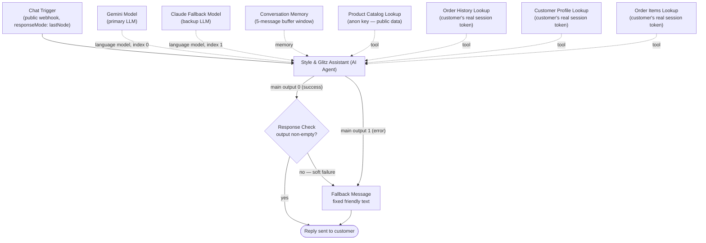

# Style & Glitz — Luxury Digital Flagship Store

A full-stack e-commerce site for fine watches and GRA-certified VVS1 moissanite jewelry — built as a cinematic, boutique-style storefront rather than a generic shop template, with a complete backend (accounts, admin dashboard, and payments) behind it.

**Live site:** https://styleandglitz.netlify.app

---

## Tech Stack

**Frontend**
- React + TypeScript, built with [Vite](https://vitejs.dev)
- [Tailwind CSS](https://tailwindcss.com) for styling
- [Framer Motion](https://www.framer.com/motion/) for page transitions and reveal animations
- [React Router](https://reactrouter.com) for client-side routing
- [Redux Toolkit](https://redux-toolkit.js.org) for cart/wishlist state (see [State Management](#state-management))

**Backend / Infrastructure**
- **[Supabase](https://supabase.com)** — Postgres database, Auth (separate admin and customer logins), Storage (product image/video uploads), and Edge Functions (serverless functions for payment processing)
- **[Paystack](https://paystack.com)** — payment processing (chosen over Stripe, which doesn't support Nigerian merchants directly)
- **[Netlify](https://netlify.com)** — hosting, with automatic deploys on every push to GitHub

**AI Assistant**
- **[n8n](https://n8n.io)** (cloud) — orchestrates the chatbot: an AI Agent with tool access to live product/order data, a dual-model fallback (Google Gemini primary, Anthropic Claude backup), and graceful-degradation error handling. See [AI Assistant](#ai-assistant-n8n-chatbot) below for the full breakdown.
- **[@n8n/chat](https://www.npmjs.com/package/@n8n/chat)** — the embeddable chat widget on the frontend, themed to match the site's own design system rather than its library defaults

**Testing**
- [Jest](https://jestjs.io) + [ts-jest](https://kulshekhar.github.io/ts-jest/) for the test runner
- [React Testing Library](https://testing-library.com/react) for component tests

---

## Getting Started

```bash
npm install
cp .env.example .env.local
npm run dev
```

### Required environment variables (`.env.local`)

| Variable | Purpose | Required? |
|---|---|---|
| `VITE_SUPABASE_URL` | Your Supabase project URL | Yes |
| `VITE_SUPABASE_ANON_KEY` | Supabase anon (public) key — safe to expose client-side; the actual access boundary is Row Level Security, not this key's secrecy | Yes |
| `VITE_IG_USER_ID` / `VITE_IG_ACCESS_TOKEN` | Instagram Graph API — for a live "Shop Our Instagram" feed | No (feed falls back to the product catalog) |
| `VITE_STRIPE_PUBLISHABLE_KEY` | Reserved for a future payments provider | No (unused — Paystack is the current processor) |
| `VITE_N8N_CHAT_WEBHOOK_URL` | The n8n Chat Trigger's production webhook URL for the AI assistant | No — the chat bubble simply doesn't mount if unset, rather than shipping in a broken state |


### Other scripts

```bash
npm run build     # tsc -b && vite build
npm run preview   # preview the production build locally
npm run lint      # ESLint
npm test          # Jest (unit + component tests)
```

---

## Design System

| Token | Hex | Used for |
|---|---|---|
| `forest` (primary) | `#0F172A` Midnight Navy | Headings, dark backgrounds, primary buttons |
| `sage` (secondary) | `#334155` Slate Blue | Muted text, secondary accents |
| `cream` (base) | `#FAF8F4` Soft Ivory | Site-wide background |
| `stone` (neutral) | `#E5E7EB` Warm Platinum | Card backgrounds, dividers |
| `gold` (accent) | `#C9A227` Brushed Gold | Prices, borders, hover states, badges |
| `graphite` (ink) | `#0B1120` | Body text |

**Typography:** Cormorant Garamond (headings), DM Serif Display (subheadings), Inter (body), IBM Plex Mono (prices, eyebrows, numeric labels)

All tokens are defined once in `tailwind.config.ts` — no hardcoded hex values should appear in component files.

---

## Pages & Routes

| Route | Purpose |
|---|---|
| `/` | Home — hero, curated collections, category diptych, featured products, reviews, Instagram-style carousel, concierge |
| `/watches`, `/moissanite` | Category pages with brand/type filtering |
| `/product/:slug` | Product detail — gallery, description, GRA certificate info, related items |
| `/cart` | Cart + checkout |
| `/wishlist` | Saved items |
| `/signup`, `/login`, `/account` | Customer accounts — signup, login, profile, order history |
| `/checkout/callback` | Landing page after Paystack payment — verifies payment server-side before confirming the order |
| `/admin/login`, `/admin`, `/admin/products/new`, `/admin/products/:id/edit` | Admin dashboard (protected, single admin account) |

---

## State Management


- **Redux Toolkit** (`src/store/`) — cart and wishlist. Both have real reducer logic worth testing in isolation (quantity increment/decrement, the "quantity ≤ 0 removes the line" edge case, toggle-on/toggle-off), so a dedicated slice with unit tests made sense.
- **React Context** — products (synced from Supabase), customer auth session, admin auth session, and cart visual-effects state (the fly-to-cart animation). These either wrap an external subscription (Supabase's auth listener) or are simple enough that a full store would be overhead without benefit.

Components consume both through custom hooks (`useCart()`, `useWishlist()`, `useProducts()`, etc.) 

---

## Testing

```bash
npm test
```

- **Reducer tests** (`src/store/*.test.ts`) — cart and wishlist slices, covering add/remove/quantity edge cases and toggle behavior.
- **Component tests** (`src/components/*.test.tsx`) — render with React Testing Library against a real (in-memory) Redux store and the app's own context providers, so assertions check actual state changes rather than mocked callbacks.
- Config lives in `jest.config.ts` (ts-jest + jsdom); `jest.setup.ts` adds `@testing-library/jest-dom` matchers and a minimal polyfill for `Element.prototype.animate` (used by the fly-to-cart animation, which jsdom doesn't implement).
- Static assets (`.mp4`, `.jpeg`, `.jpg`, `.png`, `.svg`) are mapped to a stub module (`src/__mocks__/fileMock.ts`) so importing them doesn't break the test environment.
- `src/lib/supabase.ts` returns `null` when Supabase env vars are absent, so component tests mock it out (`jest.mock("@/lib/supabase", ...)`) rather than hitting the network.

---

## Database (Supabase — `public` schema)

| Table | Purpose |
|---|---|
| `products` | Full catalog — the single source of truth once seeded; the storefront reads live from here, not from the static `src/data/*.ts` files |
| `profiles` | Customer name, phone, shipping address |
| `orders` / `order_items` | Order history, linked to the customer who placed them |
| `newsletter_subscribers` | Footer newsletter signups |

A `decrement_product_stock` Postgres function (called via RPC, not a direct table write) handles stock reduction after a confirmed order — customers can trigger this one narrow operation without needing broad write access to the `products` table.

> 
### Seeding the database

`src/data/watches.ts` and `src/data/moissanite.ts` hold the original static catalog (also used as an instant-render fallback in `ProductsContext` while the live Supabase fetch is in flight). To push that catalog into Supabase:

```bash
VITE_SUPABASE_URL=... VITE_SUPABASE_ANON_KEY=... ADMIN_EMAIL=... ADMIN_PASSWORD=... npx tsx scripts/seed-products.mjs
```

From then on, use the `/admin` dashboard to manage products — no need to touch the static files or re-run the seed script.

---

## Key Features

- **Product cards** — hover-to-video reveal on watch cards; moissanite cards autoplay their video by default (the sparkle is the point); subtle 3D tilt tracking on hover; magnetic wishlist button; fly-to-cart animation with a gold sparkle burst and a self-drawing checkmark toast on Add to Cart
- **Admin dashboard** — add/edit/delete products, direct image/video upload to Supabase Storage, locked to one specific admin email at both the database (RLS) and frontend level
- **Customer accounts** — signup/login, profile + shipping address, order history
- **Checkout** — Paystack-hosted payment page → payment verified server-side via a Supabase Edge Function (never trusts the redirect alone) → order saved → stock decremented
- **Legal disclaimer** — entry modal plus a repeated note on every product page, clarifying that pieces are independent, inspired-by designs and not licensed by the named watch brands
- **Newsletter** — real email capture into Supabase, viewable in Table Editor
- **Route-aware navbar** — solid/dark-on-cream styling on pages without a hero video, transparent-fading-to-solid on pages that have one, rather than relying on scroll position alone
- **AI shopping assistant** — a chat widget grounded in the live product catalog, store policies, and (for logged-in customers) their own real order history — see [AI Assistant](#ai-assistant-n8n-chatbot) below

---

## AI Assistant (n8n Chatbot)

A customer-facing chat widget ("Style & Glitz Assistant") answers questions about products, store policies, and — for signed-in customers — their own real order history. It's built as an n8n workflow (`Style & Glitz AI Chatbot`, 11 nodes) talking to an embedded `@n8n/chat` widget on the frontend. The guiding rule throughout: **the bot never invents a price, policy, or order detail** — everything it states is either grounded in a live tool call or explicitly deferred to a human.

### Architecture



### Node-by-node

| Node | Type | Role |
|---|---|---|
| **Style & Glitz Chat Trigger** | `chatTrigger` | Public webhook entry point. `responseMode: lastNode` — required because downstream nodes (Response Check, Fallback Message) sit inline after the Agent, which true token-streaming mode doesn't support. |
| **Style & Glitz Assistant** | `agent` | The orchestrator. `needsFallback: true` (auto-retries on the backup model), `onError: continueErrorOutput` (routes total failure to a friendly message instead of crashing). System prompt covers product grounding, store policies, how-to-order steps, and login-gated order lookup — see [System prompt contents](#system-prompt-contents). |
| **Gemini Model** | `lmChatGoogleGemini` | Primary LLM (`gemini-3-flash-preview`). Uses its **own dedicated Google Cloud project/API key**, deliberately separate from the one used by the unrelated Gmail automation workflow, so testing one never starves the other's free-tier quota. |
| **Claude Fallback Model** | `lmChatAnthropic` | Backup LLM (`claude-sonnet-4-6`). Only invoked if Gemini fails (quota, billing, outage) — `needsFallback` retries automatically, mid-conversation, with no visible interruption. |
| **Conversation Memory** | `memoryBufferWindow` | Last 5 messages, keyed by the Chat Trigger's own session ID. |
| **Product Catalog Lookup** | `supabaseTool` (anon key) | Fetches the full live product catalog (price, stock, materials, GRA certification). Public data, so the shared anon key + RLS is fine here. |
| **Order History Lookup** | `httpRequestTool` | Calls Supabase's REST API directly with the **customer's own real session token** (not the shared anon key) as the `Authorization: Bearer` header — see [Order/account lookup security](#orderaccount-lookup-security). Returns that customer's orders only. |
| **Customer Profile Lookup** | `httpRequestTool` | Same mechanism, against the `profiles` table — name, phone, saved shipping address. |
| **Order Items Lookup** | `httpRequestTool` | Same mechanism, against `order_items`, filtered by an order ID the model supplies (safe because Postgres RLS — not the model — is what actually enforces that the order belongs to the caller). Verified end-to-end with a real logged-in customer session. |
| **Response Check** | `if` | Catches a failure mode discovered during testing: the Agent's own dual-model fallback can swallow a **total** failure internally and return a normally-"succeeded" item shaped like `{ error: "..." }` with no `output` field — silently bypassing `continueErrorOutput`. This node checks `$json.output` is non-empty; if not, routes to Fallback Message too. |
| **Fallback Message** | `set` | Fixed customer-facing text for total failure: *"Sorry, I'm currently unavailable. Please reach out to us directly at +2349036423694 or styleandglitz@gmail.com and we'll help right away."* Reached from both the Agent's hard-error branch and Response Check's soft-failure branch. |

### System prompt contents

The Agent's system prompt (all static except one dynamic login-status line) covers, in order:
1. **Product grounding** — must use Product Catalog Lookup for any price/stock/material/certification claim; never invent one.
2. **Store policies** — delivery timelines (same-day Lagos, 3–7 days rest of Nigeria, 10–15 days international), returns/refunds/exchanges, the 1-year wristwatch guarantee, GRA certification, the ₦1,000,000 free-diamond-tester threshold, and the clone/lookalike authenticity disclaimer.
3. **How to place an order** — a real walkthrough of the actual site flow (`/signup` → browse → add to cart → `/cart` → sign in + saved address → Paystack), referencing pages only by relative path so the model can't invent a domain name.
4. **Order & account lookup** — a dynamic expression (`{{ $json.metadata.customerId ? ... : ... }}`) tells the model on every turn whether the current visitor is logged in. Logged in → free to use the three order/profile tools. Not logged in → must not attempt a lookup, and should warmly redirect to `/login`.
5. **Escalation** — anything outside the above (negotiation, complaints, technical failures the data can't explain) gets a clear "I can't help with that" plus the real concierge channels: WhatsApp, Instagram DM, email.

### Order/account lookup security

The interesting design problem: the chat is a fully anonymous public webhook, but order/profile data is customer PII. Two things make the lookup tools safe:

1. **Real session, not a typed claim.** `ChatWidget.tsx` reads the customer's actual Supabase Auth session (`useCustomerAuth()`) and passes `customerId` and `accessToken` into the chat as `metadata` — data the AI and the customer's own message can never override, since it's set once by trusted frontend code before the conversation starts.
2. **Real Row Level Security, not an application-level filter.** The first version of these tools used the shared anon-key credential with a `customer_id = <value>` filter built in n8n — but Postgres RLS on `orders`/`profiles`/`order_items` blocks the anon role entirely (`auth.uid()` is null for it), so that filter never had a chance to matter; the tools silently returned nothing. The fix: the lookup tools now call Supabase's REST API directly using the customer's own live access token as the bearer credential, so RLS evaluates `auth.uid()` as the real customer and enforces ownership exactly as it does for the website itself — no privileged key, no bypass, and no permanent reliance on an n8n expression being written correctly forever.

### Error handling & fallback

Two independent layers, both tested against **real failures** (a genuinely exhausted quota, a genuinely zero-balance credential — not simulated ones):

- **Model-level:** `needsFallback` on the Agent means a Gemini failure (quota/billing/outage) triggers an automatic retry on Claude, invisibly, within the same turn.
- **Total-failure-level:** if both models fail, `Response Check` + `Fallback Message` guarantee the customer sees the fixed friendly message above — covering both the "hard" failure (Agent throws, routed via `continueErrorOutput`) and the "soft" failure (Agent returns a fake success with no output) discovered during testing.

### Frontend integration (`src/components/ChatWidget.tsx` + `ChatWidget.css`)

- Reads `VITE_N8N_CHAT_WEBHOOK_URL`; if unset, the widget simply never mounts (console warning only) rather than shipping a bubble that errors on first message.
- Gated behind the disclaimer modal — doesn't mount until "I Understand" is dismissed (`App.tsx` tracks acknowledgement, passed down as a prop to `DisclaimerModal`'s `onDismiss`).
- Waits for Supabase auth to resolve (`loading` from `useCustomerAuth()`) before creating the chat, so it never captures a stale "logged out" snapshot for an actually-signed-in customer.
- Fully re-themed off the library defaults onto the site's own design system: Cormorant Garamond header, IBM Plex Mono tracked-caps subtitle/footer, the forest/gold/cream/graphite/stone palette, sharp 2px corners, a gold hairline divider, and a portrait-medallion launcher icon reusing the exact line-art person icon from the account link in `Navbar.tsx` (not a stock chat-bubble/robot icon).
- Works around one real `@n8n/chat` library bug: its built-in header close button emits an event nothing listens for. Fixed by forwarding its clicks to the launcher bubble's own (working) toggle handler.

### Known limitations

- No CI/automated test coverage for the n8n workflow itself (by nature — it lives in n8n, not this repo); changes are verified via n8n's execution history and, for frontend-facing behavior, headless-browser checks during development.

---

## Payments (Paystack)

Two Supabase Edge Functions handle payment, keeping the secret key server-side:

- `initialize-payment` — starts a transaction, returns the hosted payment page URL
- `verify-payment` — confirms with Paystack directly whether a payment actually succeeded (cart contents travel through Paystack's own `metadata` field, not browser storage, since `sessionStorage`/`localStorage` proved unreliable across the redirect round-trip)

**Required Supabase secrets** (Edge Functions → Manage secrets):

| Secret | Value |
|---|---|
| `PAYSTACK_SECRET_KEY` | Your Paystack secret key (`sk_test_...` or `sk_live_...`) |
| `SITE_URL` | Your deployed site's exact URL, no trailing slash |

Switching between Paystack test and live mode only requires swapping `PAYSTACK_SECRET_KEY` — no code changes, no redeploy.

---

## Deployment

Connected to Netlify via GitHub — every push to `main` triggers an automatic deploy.

- **Build command:** `npm run build`
- **Publish directory:** `dist`
- **Required Netlify environment variables:** `VITE_SUPABASE_URL`, `VITE_SUPABASE_ANON_KEY` — must be added in Netlify's site settings separately, since `.env.local` is git-ignored and never uploaded
- **`VITE_N8N_CHAT_WEBHOOK_URL` is intentionally not set in Netlify yet** — it currently only exists in local `.env` for development testing. The AI assistant is fully built and live in n8n, but adding this variable to Netlify (making the chat bubble reachable by real customers) is a deliberate go-live step, not an oversight.
- **`public/_redirects`** contains `/* /index.html 200` — required for a single-page app on Netlify, otherwise direct links to any route other than `/` 404

---

## Known Gaps / Not Yet Done

- **CI test automation** — Jest tests currently run locally only (`npm test`); a GitHub Actions workflow to run them automatically on every push/PR is planned but not yet wired up
- **Component-level RTL tests** — coverage so far is the cart/wishlist reducers plus `ProductCard`; interaction tests for checkout, admin, and auth flows are the next planned addition
- **Shop Our Instagram** section currently pulls from the product catalog, not a live Instagram feed — real sync via the Instagram API (Instagram Login flow, no Facebook Page required) is in progress
- **Shipping / Returns / Privacy / Terms** footer links point to homepage anchors that don't exist yet — need either real written policy pages or placeholder pages
